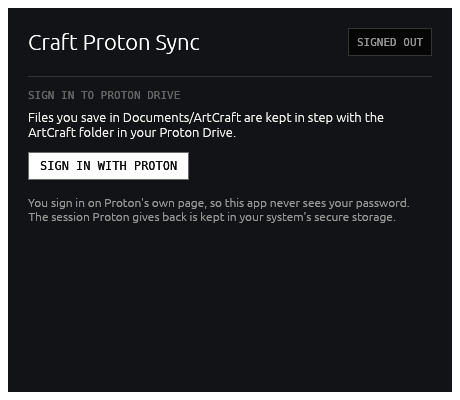
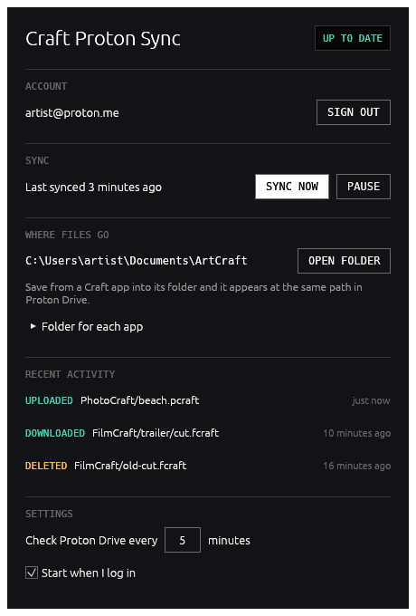

<h1 align="center">Craft Proton Sync</h1>

<p align="center">
  <b>Save from a Craft app, find it in Proton Drive.</b><br>
  A small native tray app that keeps your ArtCraft folder in step with Proton Drive, in pure Rust.
</p>

<p align="center">
  
  
  
  
</p>

<p align="center">
  
  
</p>

> [!IMPORTANT]
> **Unofficial and early.** This project is not affiliated with or endorsed by Proton AG or the
> ArtCraft Team. It talks to Proton Drive through Proton's own
> [Drive CLI](https://proton.me/blog/proton-drive-cli), which is itself pre-release. Keep your
> own backups of work you care about.

## What it does

1. **Sign in to Proton Drive** from the app, once. You sign in on Proton's own page in your browser.
2. **Save a file from a Craft app** into its folder under `Documents/ArtCraft`.
3. **It is synced to Proton Drive**, at the same path under `/ArtCraft`, about a quarter of a minute later.

Changes made on your other devices come back down the same way: the sync is two-way.

## Where files go

| On this computer | In Proton Drive |
|---|---|
| `Documents/ArtCraft/PhotoCraft/beach.pcraft` | `/ArtCraft/PhotoCraft/beach.pcraft` |
| `Documents/ArtCraft/FilmCraft/trailer/cut.fcraft` | `/ArtCraft/FilmCraft/trailer/cut.fcraft` |
| `Documents/ArtCraft/<anything>` | `/ArtCraft/<anything>` |

The app creates a folder for each app in the Craft App Suite (PhotoCraft, LightCraft, FilmCraft,
DesignCraft, VectorCraft, PdfCraft, EffectCraft, WordCraft, DeckCraft, GridCraft, CADCraft,
SoundCraft) on both sides. The Craft apps need no changes: save into those folders with their
normal Save dialog.

## How it works

- **One download, nothing else to install.** On first run the app fetches Proton's Drive CLI
  (about 100 MB, once) from `proton.me` and runs it only after the download matches the SHA-512
  compiled into the app. The CLI is built by Proton on the SDK their own apps use; it lists,
  uploads, downloads and trashes. The syncing itself, deciding what goes where, is this app's.
- **A sync runs** a few seconds after the folder goes quiet following a save, and every few
  minutes (5 by default) to pick up changes made elsewhere. **Sync now** runs one at once.
- **Nothing is deleted for good.** A file you delete on one side is moved to the Recycle Bin /
  Trash on this computer, or to Proton Drive's trash. An upload over an existing file becomes a
  new revision, so the old content stays in the file's history in Proton Drive.
- **Conflicts keep both copies.** When a file changed on both sides between syncs, the Proton
  Drive copy keeps the name and yours is kept beside it as `name (conflict 2026-10-12 2104).ext`.
- **A missing side is not an empty side.** If the folder disappears from this computer or from
  Proton Drive (a disk unplugged, a folder renamed), or Proton Drive can't be reached, the sync
  stops and says so instead of deleting everything on the other side.
- **Scratch files stay local**: `*.tmp`, `*.partial`, `~$*`, `.DS_Store`, `Thumbs.db` and the like.
- **It lives in the tray.** Closing the window keeps it syncing; it can start when you log in.

## Your password

The app never sees it. **Sign in with Proton** opens Proton's sign-in page in your browser (the
link can also be copied, to sign in on another device); your password and two-factor code go only
to Proton. The session Proton gives back is kept by the CLI in your system's secure storage:
Windows Credential Manager, macOS Keychain, or libsecret (GNOME Keyring, KWallet) on Linux.
**Sign out** deletes it. If you also use Proton's Drive CLI yourself, it shares that session.

## Updates

The app looks at this project's [releases](https://github.com/Milkshak3s/craft-proton-sync/releases)
when it starts and once a day after that. That request goes to GitHub and carries nothing about
you beyond what any download does.

- **Update now.** When a newer version is out, the Updates section says so and **Update now**
  installs it: the package for your computer is downloaded, checked against the release's
  `SHA256SUMS.txt`, swapped in for the running program, and the app starts again as the new
  version. It never interrupts a sync.
- **Install new versions automatically** is off by default. Turned on, the same thing happens
  without asking whenever a new release is published.
- If the app is somewhere it can't write (a system folder, a read-only disk), it says so and you
  download the new version from the releases page yourself.

Version 0.1.0 has no updater: install 0.2.0 or later by hand once.

## Known limits

- Changes from other devices arrive on the timer, not instantly.
- Deleting or renaming a *folder* is not carried over: its files are (a rename is a delete and an
  upload), but the empty folder stays on the other side.
- File names with `\ / : * ? " < > |`, or ending in a dot or space, are skipped, so that what
  syncs works on every desktop.
- The synced folder can only be changed by editing `local_root` in `settings.json` in the app's
  data folder (`%LOCALAPPDATA%\craft-proton-sync`, `~/Library/Application Support/craft-proton-sync`
  or `~/.local/share/craft-proton-sync`).
- On Linux a secret store (libsecret) must be running, and on Wayland a window can't be hidden
  and shown again, so there the close button quits the app.
- English only. Builds are not code-signed, and there are no installers yet (see below).
- Only "My files" in Proton Drive is synced; shared folders, Photos and devices are not.

## Downloads

[**Download the latest release**](https://github.com/Milkshak3s/craft-proton-sync/releases/latest). Releases have a portable `.zip` for Windows (x64, arm64), a universal `.dmg` for macOS and a
`.tar.gz` for Linux (x86_64, aarch64), with `SHA256SUMS.txt`. (The `.app.tar.gz` is the macOS
bundle on its own, which the app updates itself from.) The builds are not code-signed:
Windows SmartScreen and macOS Gatekeeper will warn on first launch (on macOS, right-click the
app and choose Open).

## Build from source

Rust 1.90 or newer. On Linux, the egui/winit headers first:

```sh
sudo apt-get install libxkbcommon-dev libwayland-dev libx11-dev libxrandr-dev libxi-dev libgl1-mesa-dev
```

```sh
cargo run --release -p craft-proton-sync
```

Checks, as CI runs them:

```sh
cargo fmt --all -- --check
cargo clippy --workspace --all-targets --locked -- -D warnings
cargo test --workspace --locked
cargo test -p craft-proton-sync-native --test cli --locked -- --ignored   # downloads the Proton Drive CLI and runs it
```

The workspace follows [ArtCraft Launcher](https://github.com/storytold/craft-launcher):
`crates/core` (pure logic, including the sync planner), `crates/native` (the CLI, sign-in, the sync engine),
`crates/ui-egui` (the interface) and `apps/craft-proton-sync` (window and tray).
[AGENTS.md](AGENTS.md) has the map and the rules.

## Releasing

Set the version in `[workspace.package]` in `Cargo.toml` and push to the `release` branch.
`.github/workflows/release.yml` builds every platform and creates a draft GitHub Release.

## License

MIT or Apache-2.0, at your option ([LICENSE-MIT](LICENSE-MIT), [LICENSE-APACHE](LICENSE-APACHE)).
See [NOTICE](NOTICE) for trademarks and third-party material.
